# VTab Explorer

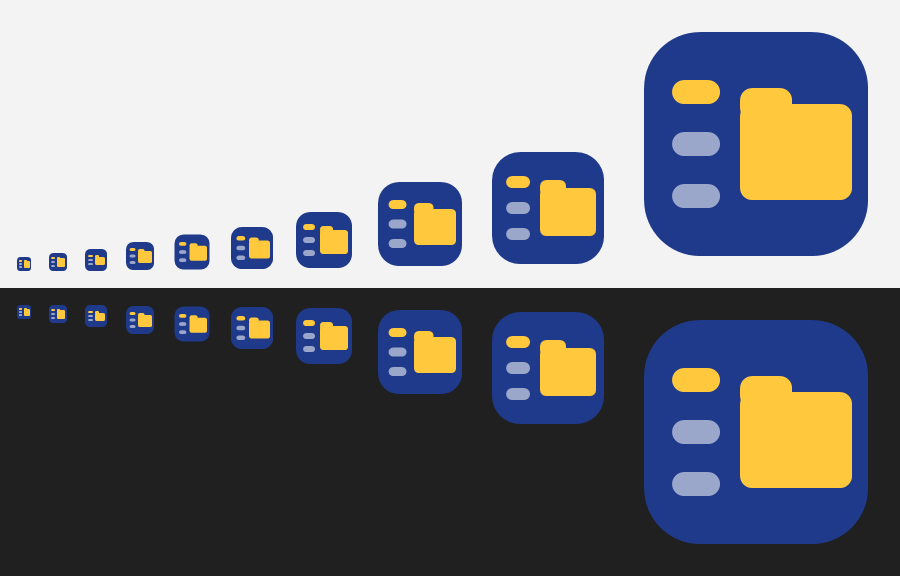

タブを左側に縦に並べる、Windows 用のファイルエクスプローラーです（C# / WPF）。

## 主な機能

- **縦タブ**: タブを左に縦に並べる。タブごとに戻る／進むの履歴を持ち、終了時のタブは次回起動時に復元される
- **ドラッグ＆ドロップ**: フォルダやタブへファイルをドラッグして移動・コピーできる。ファイルを持ったままタブの上で止めると、そのタブに切り替わる
- **基本的なファイル操作**: 新しいフォルダー、新しいテキスト、コピー、切り取り、貼り付け、名前の変更、削除（ごみ箱へ）
- **標準エクスプローラーと同じ右クリックメニュー**（「送る」「新規作成」や、ほかのアプリが追加した項目も含む）
- **元に戻す（Ctrl+Z）・やり直す（Ctrl+Y）**: 削除・移動・コピー・名前の変更・新規作成を、最大 100 件まで順に戻せる
- フォルダの中身が変わると、一覧を自動で更新する
- **スキン（着せ替え）**: コマンドバー右端の「スキン」から 15 種類の見た目を選べる。選んだスキンは次回起動時も使われる。ファイルとドライブのアイコンは、どのスキンでも拡張子などに応じた Windows のアイコンを出す
- **プレビュー（Alt+P）**: 選んだファイルの中身を右側に表示する。画像・テキスト（Shift_JIS も可）はアプリで、Excel・Word・PowerPoint・PDF などは Windows のプレビュー機能（エクスプローラーと同じもの）で表示する
- **パンくずリスト**: アドレスバーを「PC › D: › 案件 › 見積」のように区切って表示し、途中の階層をクリックで移動、中クリックで新しいタブに開ける。クリックで入るとパスの入力欄になる。上の階層へ移ると、来たフォルダを選んだ状態で一覧にフォーカスが移るので、そのまま矢印キーで選べる
- **パスのコピー**: 右クリックの「パスをコピー」（Ctrl+Shift+C）「名前をコピー」。ネットワークドライブ上では「共有フォルダのパス（\\サーバー\共有\…）でコピー」も使える。今のフォルダのパスは、アドレスバーの右のコピーのボタンでもコピーできる。パンくずを右クリックすると、右クリックした階層のパスもコピーできる
- **ターミナル・VS Code で開く**: タブの右クリックから、そのフォルダを Windows Terminal（なければ PowerShell）や VS Code で開ける
- **文字キーで項目へ移る**: ファイル一覧で文字キーを押すと、その文字で始まる名前の項目へ移る（エクスプローラーと同じ。詳しくは下記）
- **キーボードでの行き来**: ファイル一覧で ← を押すとタブ列へ、タブ列で → か Enter でファイル一覧へ戻れる。F6 で場所を順に巡り、Alt+T / B / D / F で直接移れる。今いる場所は枠で囲み、画面の下に使えるキーを出す（詳しくは下記）
- **タイル表示**: 分割ボタンの左のボタン（Ctrl+Alt+V）で、詳細表示とタイル表示（サムネイル付き）を切り替えられる。画像・動画・PDF などは Windows と同じサムネイルが出る。タブごとに覚える
- **並べ替え**: 一覧の列の見出し（名前・更新日時・種類・サイズ）を押すと、その列で並べ替える。もう一度押すと逆順。タブごとに覚え、新しいタブは名前の昇順から始まる。見出しの間の罫線をドラッグすると、列の幅を変えられる
- **範囲選択**: 一覧の何もない所からドラッグすると、四角で囲んだ項目を選ぶ（Ctrl を押しながらだと今の選択に足す）。詳細表示では、行の名前の列より右から始めても範囲選択になる（名前の上からのドラッグは、これまでどおりファイルを運ぶ）。一覧の端より外へ引っぱると、スクロールしながら選び続ける
- **画面分割**: コマンドバー右の分割ボタン（Ctrl+Alt+1 / 2 / 4）で、1 画面・左右 2 分割・4 分割を切り替えられる。枠ごとに別のタブを表示し、枠の間でドラッグ＆ドロップできる（詳しくは下記）
- **フォルダ内の検索**: アドレスバー右端の虫めがね（Ctrl+F）で検索欄が開き、入力すると今のフォルダを絞り込み、Enter でサブフォルダまで検索する。ふだんは虫めがねだけにして、パスを広く表示する
- **ピン留め**: タブの右クリックの「タブをピン留め」で、タブ列の一番上に固定する。ピン留めしたタブは閉じるボタンが出ず、Ctrl+W でも閉じない。ピン留めしたタブで別のフォルダへ移ると、新しいタブで開き、ピン留めしたタブのフォルダは変わらない
- **タブの記号**: タブの記号で場所を見分けられる。この PC のフォルダ、PC（ドライブの一覧）、ネットワーク（ファイルサーバー）、取り外せるドライブで記号が変わり、ネットワークはスキンごとの色が付く。記号にマウスを合わせると種類が出る
- **ホームボタン**: コマンドバー左の家のボタン（Alt+Home）で、PC（ドライブの一覧）を表示する
- **お気に入り**: タブ列の上の「お気に入り」欄からワンクリックで開ける（詳しくは下記）
- **クイックジャンプ（Ctrl+P）**: フォルダ名の一部を打つだけで、開いているタブ・お気に入り・よく使うフォルダから探して開ける
- **1 つのウィンドウにまとめる**: 起動中にもう一度起動したりフォルダを開いたりすると、起動中のウィンドウの新しいタブで開く
- **既定のファイラー**: 設定（歯車）から、フォルダやドライブを開くアプリを VTab Explorer にできる。ごみ箱やコントロールパネルなどの特殊なフォルダは、Windows のエクスプローラーに任せる
- **ホットキーと常駐**: 好きなキーの組み合わせで呼び出せる。閉じても通知領域に常駐させたり、Windows の起動時に常駐を始めたりできる
- **オンラインアップデート**: 設定の「更新」から、GitHub のリリースにある新しい版へ更新できる（ダウンロードして実行ファイルを置き換え、起動し直す。タブはそのまま）。新しい版が出たら知らせる設定もある

### キーボードでの行き来

| 場所 | キー | 動き |
|---|---|---|
| どこでも | F6 / Shift+F6 | タブ列 → お気に入り → アドレスバー → 枠 1 → 枠 2 … の順に巡る |
| どこでも | Alt+T / Alt+B / Alt+D / Alt+F | タブ列 / お気に入り / アドレスバー / ファイル一覧へ |
| ファイル一覧 | Enter | 開く |
| ファイル一覧 | Shift+Enter | フォルダを新しいタブで開いて、そのタブへ移る |
| ファイル一覧 | Ctrl+Enter | フォルダを新しいタブで開く（今のタブのまま） |
| ファイル一覧 | ← | タブ列へ（タイル表示では、左端の列にいるとき） |
| ファイル一覧 | 文字キー | その文字で始まる名前の項目へ |
| タブ列 | ↑↓ | タブを選ぶ（選んだタブがすぐ右に表示される） |
| タブ列 | → / Enter | ファイル一覧へ |
| タブ列 | Delete / Ctrl+↑↓ | タブを閉じる / 並べ替える |
| お気に入り | Enter / Ctrl+Enter | 開く / 新しいタブで開く |
| お気に入り | Delete / Ctrl+↑↓ / → | 外す / 並べ替える / ファイル一覧へ |

ファイル一覧で文字キーを押すと、その文字で始まる名前の項目へ移ります（大文字と小文字は区別しません）。

- 続けて打つと、その文字列で始まる名前を探します（例: `rep` で `report.docx`）
- 同じ文字をくり返し押すと、その文字で始まる項目を順に巡ります
- 1 秒ほど間を空けると、最初から探し直します
- 日本語入力がオンでも、ファイル一覧にいるあいだはオフにして、文字キーで移れるようにします（ほかの欄へ移ると元に戻ります）。日本語の名前で探したいときは、ファイル一覧で日本語入力をオンにして打ち、確定してください

キーボードで操作しているあいだは、今いる場所を枠で囲み、キーのカーソルがある項目を点線で示します（選択の塗りとは別）。画面の下の帯には、その場所で使える主なキーを出します（設定の「キー操作の案内を表示する」で消せます）。

### 画面分割

- 枠をクリックすると、その枠が「作業中」になります（枠線と見出しの色で示します）。アドレスバー・コマンドバー・検索欄は、作業中の枠に対して働きます
- 左のタブを選ぶと、作業中の枠にそのタブを表示します。別の枠に表示中のタブを選ぶと、その枠が作業中になります。枠に表示中のタブには、枠の番号が付きます
- 分割を増やしたときは、まだ表示していないタブを空いた枠に出します（足りなければ、今のフォルダのタブを作ります）
- ファイルを別の枠にドラッグすると、その枠のフォルダへコピー／移動します
- F6（Shift+F6）で次（前）の枠へ移ります。枠の境目はドラッグで大きさを変えられます

### フォルダ内の検索

検索欄（Ctrl+F）に入力すると、今のフォルダの中を名前で絞り込みます（空白で区切ると、すべてを含むものだけ）。Enter を押すとサブフォルダまでたどって探し、「場所」の列に見つかったフォルダを表示します（最大 5,000 件）。Esc で検索をやめます。別々のフォルダにある検索結果をまとめて選んだときは、右クリックメニューは出せません。

### お気に入り

| 操作 | 方法 |
|---|---|
| 登録する | アドレスバーの ☆ か Ctrl+D（もう一度押すと外れる）、タブやフォルダの右クリックの「お気に入りに追加」、フォルダやタブをお気に入り欄にドラッグ |
| 開く | クリックで今のタブ、中クリックか Ctrl+クリックで新しいタブ。Ctrl+1〜9 で上から順に開く（Shift も押すと新しいタブ。テンキーの数字でもよく、アドレスバーや検索欄にいるときも効く。各お気に入りの右端に「Ctrl+1」のように表示）。Alt+B でお気に入り欄へ移り、↑↓ と Enter でも開ける |
| 並べ替える | お気に入りをドラッグ |
| 外す | 右クリックの「お気に入りから外す」 |
| ファイルを送る | お気に入りの真ん中にファイルを落とすと、そのフォルダへコピー／移動（Ctrl+Z で戻せる）。上下の端や「お気に入り」の見出しに落とすと登録になる |

初めて使うときは、デスクトップ・ドキュメント・ダウンロードが入っています。見つからなくなったフォルダは薄く表示されます。

### クイックジャンプ（Ctrl+P）

コマンドバー右のフォルダのボタンか Ctrl+P で開き、フォルダ名の一部を入力します（空白で区切ると、すべてを含むものに絞り込み）。候補は、開いているタブ、お気に入り、よく使うフォルダから探します。↑↓ で選んで Enter で開き、Ctrl+Enter で新しいタブに開きます。フォルダのパスをそのまま入力して開くこともできます。

「よく使うフォルダ」は、開いた回数と、最後に開いた日時から自動で選ばれます（最近開いたものほど上に来ます）。記録は `%APPDATA%\VTabExplorer\history.json` に保存されます。

### 既定のファイラーにする

設定（コマンドバー右端の歯車）の「既定のファイラー」で「既定にする」を押すと、デスクトップやスタートメニューなどでフォルダやドライブを開いたときや、アプリが動作を指定してフォルダを開いたときに、VTab Explorer の新しいタブで開くようになります。従来版の Outlook のリンクはこの仕組みを通らずにエクスプローラーを開くので、開いた窓を閉じてタブに取り込みます（一瞬エクスプローラーの窓が見えます。Outlook から開いた窓だけが対象で、ほかのアプリから開いた窓や、もともと開いていた窓には触りません。ほかのタブがあるエクスプローラーの窓は閉じません。起きたことは設定の保存先の `explorer-capture.log` に残ります）。

- 書き換えるのは現在のユーザーのレジストリ（`HKEY_CURRENT_USER\Software\Classes\Directory` と `Drive`）だけで、管理者権限はいりません
- ごみ箱・コントロールパネルなどの特殊なフォルダ、ファイルを選んだ状態でフォルダを開く機能（ブラウザの「フォルダを開く」など）、ファイルを開く・保存するダイアログは、これまでどおり Windows の画面です
- 既定にしていても、Windows のエクスプローラーのウィンドウでフォルダをダブルクリックしたときは、そのエクスプローラーのまま開きます（設定の「エクスプローラーの中ではエクスプローラーで開く」でオフにできます）
- 標準のエクスプローラーを使いたいときは、タブの右クリックの「Windows のエクスプローラーで開く」で、そのフォルダをエクスプローラーで開けます
- アプリを削除する前に「元に戻す」を押してください

### ホットキーと常駐

設定の「ホットキーと常駐」で使えます。

| 設定 | 内容 |
|---|---|
| 呼び出すホットキー | 欄をクリックして、Ctrl・Alt・Win のどれかと一緒にキーを押すと登録される（どのアプリを使っていても反応し、そのキーはほかのアプリに届かなくなるので、Ctrl+Shift+E のように重なりにくい組み合わせがおすすめ）。押すとウィンドウが前面に出て PC（ドライブの一覧）を表示する（PC のタブがあればそれを選ぶ）。すでに前面にあるときは、PC の新しいタブを開く。どちらのときも、ファイル一覧にフォーカスを置くので、すぐ矢印キーや文字キーで項目を選べる |
| 閉じても通知領域に常駐する | 閉じるボタンでは終了せず、通知領域（タスクバー右下）にしまう。終了は通知領域のアイコンの右クリックから |
| Windows の起動時に常駐を始める | サインインしたときに、ウィンドウを出さずに常駐する（現在のユーザーのスタートアップに登録） |

Win+E の置き換えは、Windows 11 25H2 で効かなかったため対応していません。代わりにホットキーを使ってください。

### スキン一覧

| スキン | 雰囲気 | フォント |
|---|---|---|
| ミッドナイト・キャンディ（標準） | アイコンと同じ紺と黄色、丸いカプセル型 | M PLUS Rounded 1c |
| ふせんノート | クリーム色の紙と、タブごとに色の違うインデックス | Klee One |
| ポップ・ブルータル | 太い黒線とビビッドな色 | M PLUS Rounded 1c |
| レトロゲーム | 携帯ゲーム機風の 4 色とドット文字 | DotGothic16 |
| サイバー・ネオン | 黒地に水色とピンクの細い線 | Zen Kaku Gothic New |
| カーボン・レーサー | 炭色とオレンジ、斜めに切ったタブ | Zen Kaku Gothic New |
| 墨と朱 | 墨の黒、和紙の生成り、朱の差し色 | しっぽり明朝 |
| モノクロ・エディトリアル | 白と黒に赤を一点、番号付きのタブ | Zen Kaku Gothic New |
| クリームソーダ | メロンソーダの緑とさくらんぼの赤 | Kiwi Maru |
| ナイトスカイ | 夜空の藍と月の黄色 | Zen Maru Gothic |
| ハイコントラスト・黒 | 黒地に白文字、強調は黄色と水色。文字と背景のコントラスト比は 7:1 以上 | Zen Kaku Gothic New |
| ハイコントラスト・白 | 白地に黒文字、強調は青と赤紫。文字と背景のコントラスト比は 7:1 以上 | Zen Kaku Gothic New |
| スレート | 目が疲れにくい落ち着いた灰青 | Zen Kaku Gothic New |
| モスグリーン | 苔の緑と木の色 | Zen Maru Gothic |
| スタンダード | Windows 標準に近い見た目 | Yu Gothic UI |

| | |
|---|---|
| 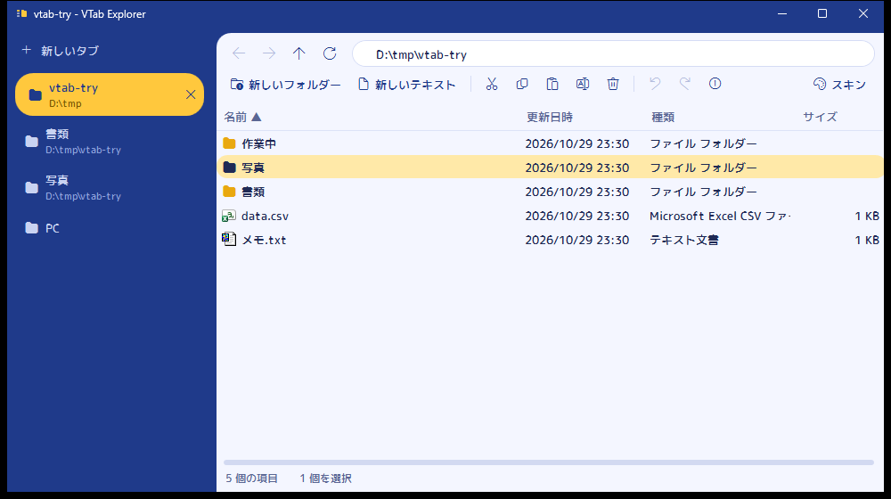 | 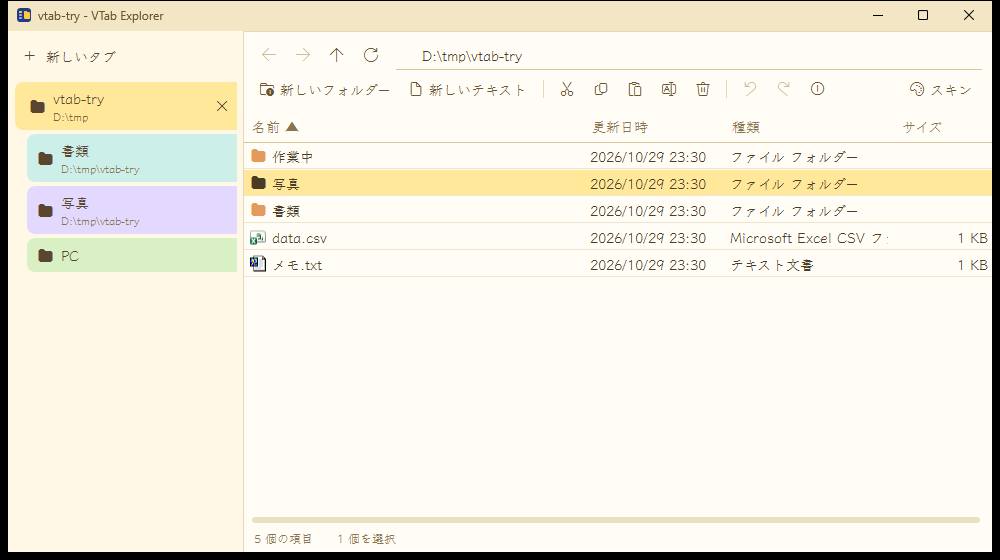 |
| 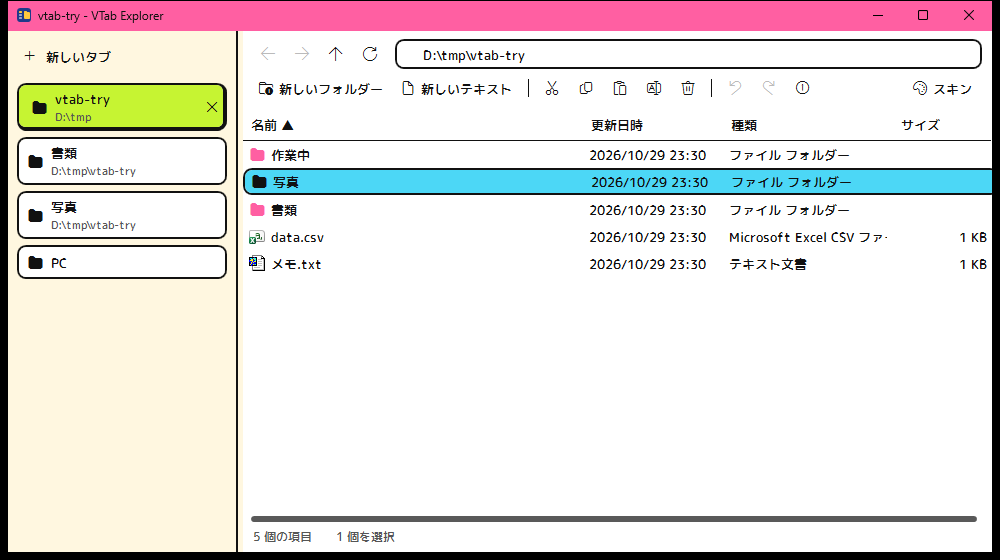 | 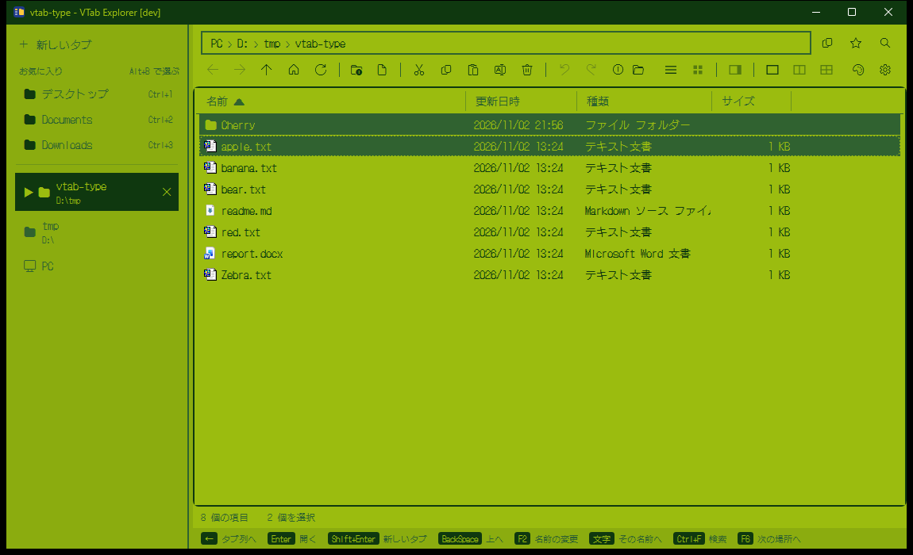 |
| 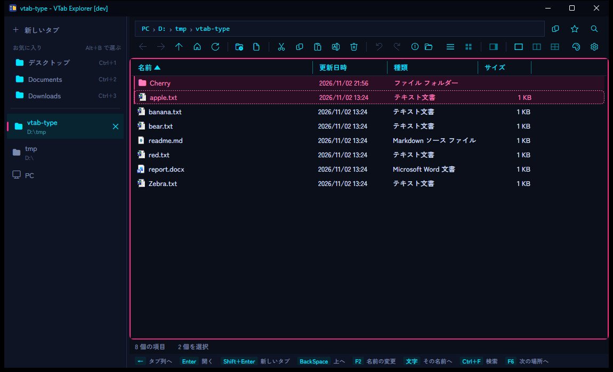 | 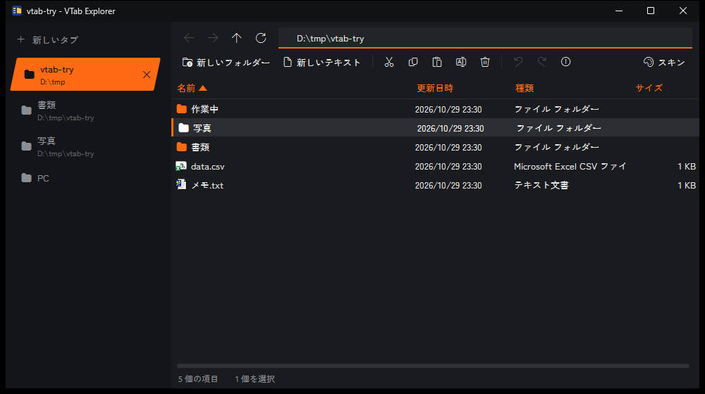 |
| 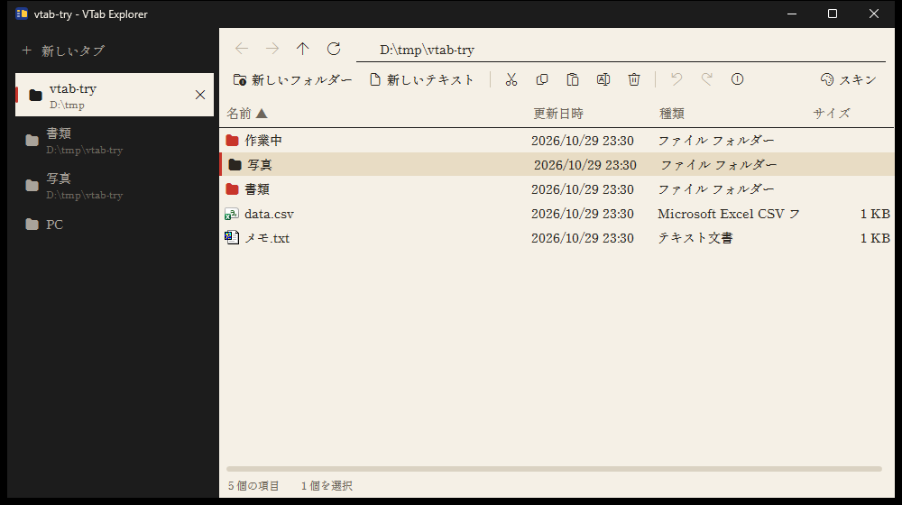 | 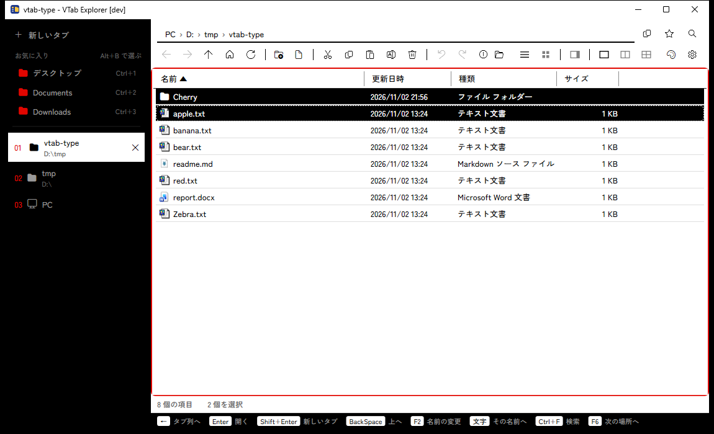 |
| 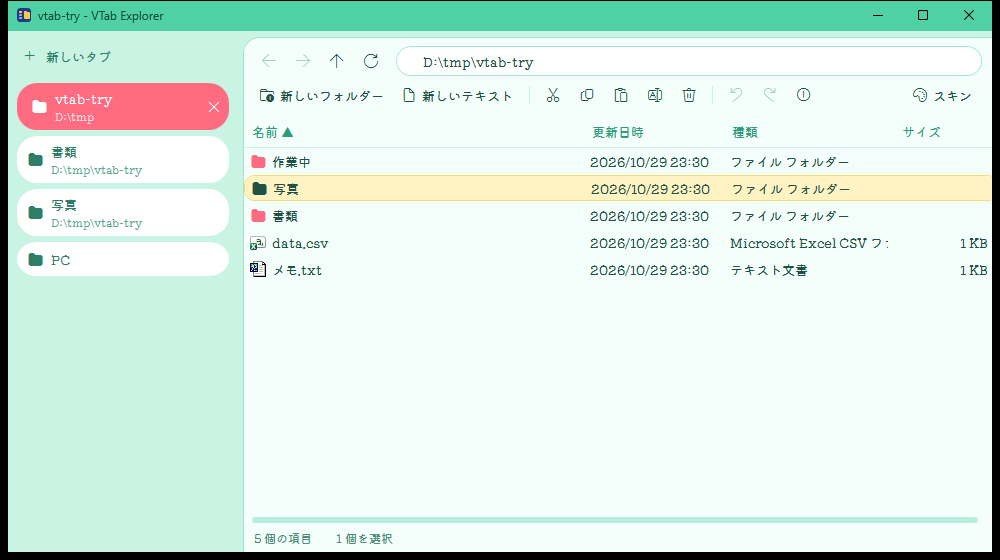 | 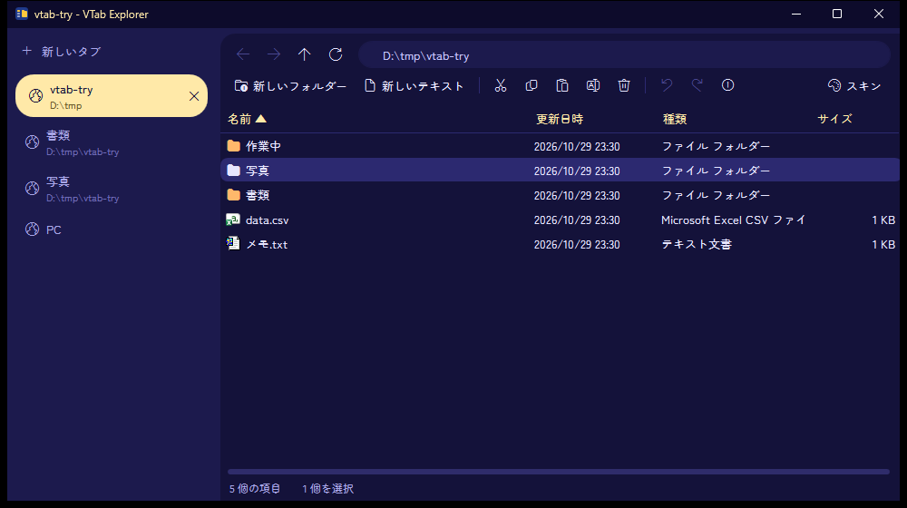 |
| 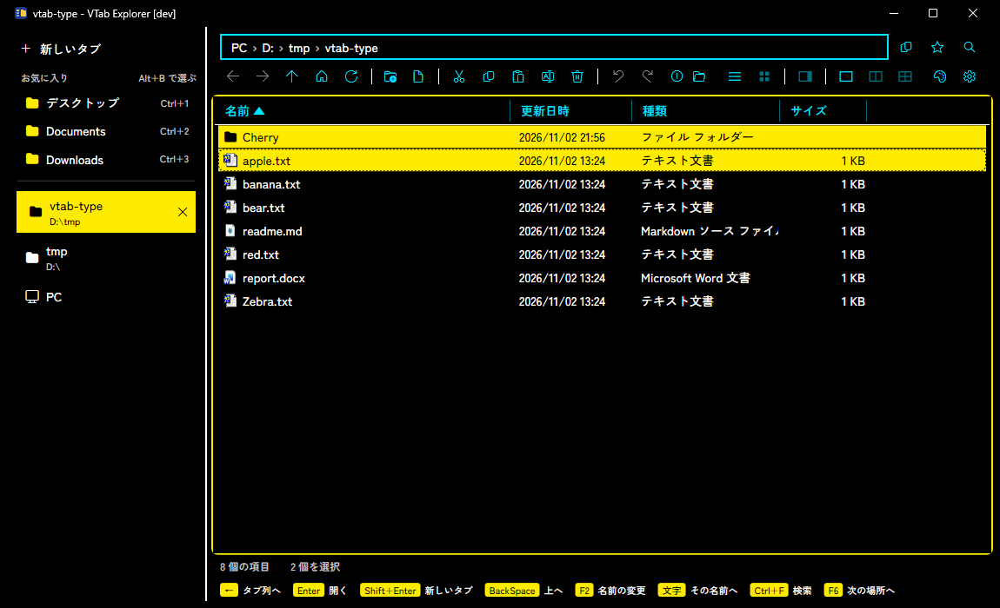 | 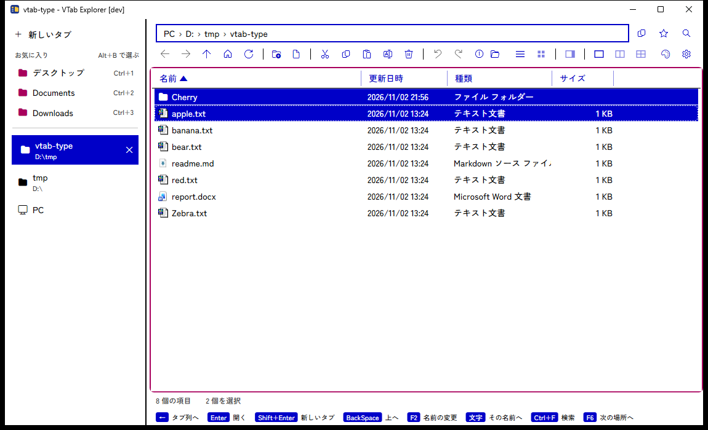 |
| 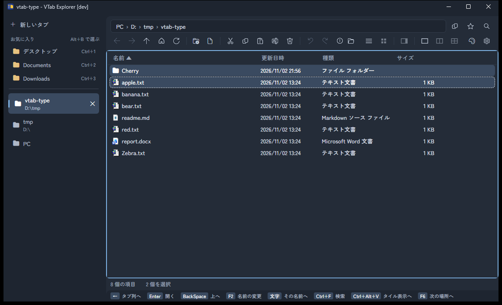 | 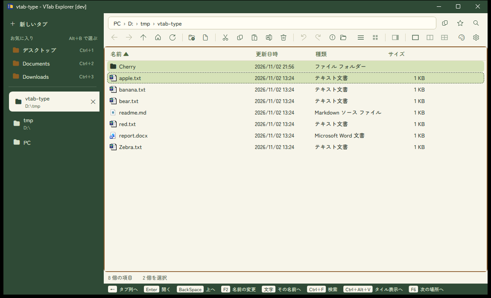 |
| 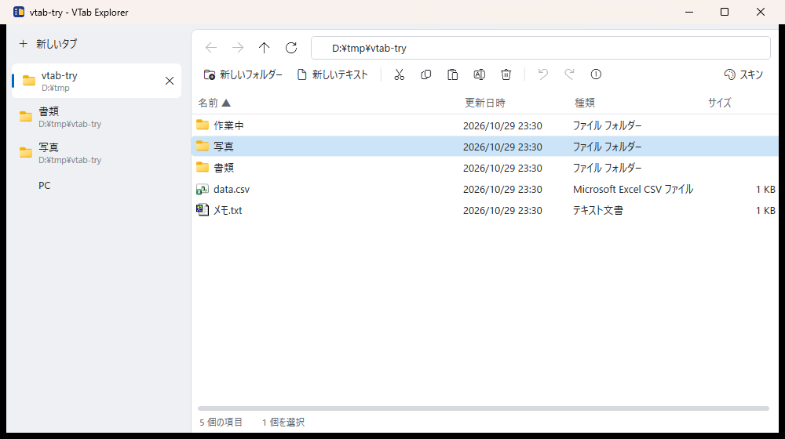 | 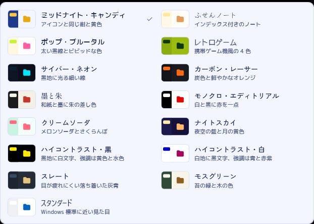 |

## 動作環境

- Windows 10 / 11
- [.NET 10 デスクトップ ランタイム](https://dotnet.microsoft.com/download/dotnet/10.0)

## 使い方

[リリース](../../releases) から zip をダウンロードして展開し、`VTabExplorer.exe` を実行します。動かすのに必要なのは `VTabExplorer.exe` 1 つだけです（フォントも exe の中に入っています）。zip には、利用条件の `LICENSE.txt` とフォントのライセンスの `THIRD-PARTY-NOTICES.txt` も入っています。[.NET 10 デスクトップ ランタイム](https://dotnet.microsoft.com/download/dotnet/10.0) が必要です。

ランタイム同梱版は v0.10.6 までです。同梱版を使っている場合、設定の「更新」を押すとリリースのページが開くので、ランタイムを入れてから zip で入れ替えてください。

2 回目からは、設定の「更新」の「確認する」→「更新する」で新しい版にできます。置いてある場所の exe をそのまま置き換えるので、zip を展開し直す必要はありません（置き換えた古い exe は、次に起動したときに消します）。

### ポータブル版として使う

実行ファイルの隣に `portable` という名前の空のファイル（`portable.txt` でも可）を置くと、設定・タブの状態・よく使うフォルダの記録を、実行ファイルの隣の `data` フォルダに保存します。USB メモリや共有フォルダに置いて使え、PC の `%APPDATA%` に何も残しません。

### 会社の PC で使うときに

- インターネットと通信するのは、新しい版の確認とダウンロード（GitHub の `api.github.com` と `github.com`、ダウンロードの転送先 `release-assets.githubusercontent.com`）のときだけです。Windows のプロキシの設定に従い、プロキシが認証を求めたときは、ブラウザと同じように Windows のログオン情報で答えます。それで通れないダウンロードは、Windows の機能（WinINet）に任せ、必要なら Windows の入力画面を出します（パスワードはアプリを通りません）。自動の確認は、設定の「新しい版が出たら知らせる」をオフにすると止まり、「確認する」を押したときだけになります
- レジストリを書き換えるのは、設定で自分で選んだときだけです（「既定のファイラー」は `HKEY_CURRENT_USER\Software\Classes`、「Windows の起動時に常駐を始める」は `HKEY_CURRENT_USER\...\Run`）。どちらも「元に戻す」「オフにする」で消えます
- 設定などの保存先は `%APPDATA%\VTabExplorer`（ポータブル版では実行ファイルの隣の `data`）だけです
- 右クリックメニュー・サムネイル・プレビューは Windows の仕組みを使うため、Office や 7-Zip などほかのアプリが追加した機能も動きます
- 実行ファイルには署名がないため、Windows の SmartScreen の警告が出たり、会社の設定（AppLocker など）で起動が止められたりすることがあります。使う前に社内の決まりを確認してください

### フォルダを指定して起動する

フォルダのパスを引数に渡すと、そのフォルダを新しいタブで開きます。

```
VTabExplorer.exe "D:\work"
```

### キーボード操作

| キー | 動作 |
|---|---|
| Ctrl+T / Ctrl+W | タブを開く（PC から始まる）／閉じる |
| Ctrl+Tab | 次のタブへ |
| Alt+← / Alt+→ / Alt+↑、BackSpace | 戻る／進む／上のフォルダへ |
| Ctrl+L | アドレスバーへ移動 |
| Ctrl+P | クイックジャンプ |
| Ctrl+F / F3 | フォルダ内の検索 |
| Alt+Home | PC（ドライブの一覧）へ |
| Ctrl+Alt+1 / 2 / 4 | 画面分割を切り替え（1 画面・2 分割・4 分割） |
| Ctrl+Alt+V | 詳細表示とタイル表示を切り替え |
| Alt+P | プレビューの表示／非表示 |
| Ctrl+Shift+C | 選んだ項目（なければ今のフォルダ）のパスをコピー |
| F6 / Shift+F6 | 次／前の場所へ（タブ列・お気に入り・アドレスバー・各枠） |
| Alt+T / Alt+B / Alt+D / Alt+F | タブ列 / お気に入り / アドレスバー / ファイル一覧へ |
| Ctrl+D | 今のフォルダをお気に入りに追加／外す |
| Ctrl+1〜9（Shift も押すと新しいタブ。テンキーも可） | お気に入りを上から順に開く |
| Shift+Enter / Ctrl+Enter | フォルダを新しいタブで開く（そのタブへ移る／今のタブのまま） |
| F5 | 最新の情報に更新 |
| Ctrl+C / Ctrl+X / Ctrl+V | コピー／切り取り／貼り付け |
| Ctrl+A | すべて選択 |
| Delete / Shift+Delete | ごみ箱へ移す／完全に削除する |
| F2 | 名前の変更 |
| 名前の変更中に Tab / Shift+Tab | 保存して、次／前の項目の名前の変更へ（端まで行ったら反対の端へ） |
| Ctrl+Shift+N | 新しいフォルダー |
| Ctrl+Z / Ctrl+Y | 元に戻す／やり直す |
| Alt+Enter | プロパティ |
| （設定したホットキー） | どこからでもウィンドウを前面に出す。PC（ドライブの一覧）を表示する。前面にあるときは PC の新しいタブを開く |
| アプリケーション キー、Shift+F10 | 右クリックメニュー |

## 利用条件

無償で利用できます（業務での利用も可）。再配布はできません。詳しくは [LICENSE.txt](LICENSE.txt) を見てください。ソースコードは公開していません。

## フォントのライセンス

スキン用に、次のフォントを実行ファイルの中に同梱しています。いずれも [SIL Open Font License 1.1](https://openfontlicense.org) で、各ライセンス文書は [THIRD-PARTY-NOTICES.txt](THIRD-PARTY-NOTICES.txt) にあります（取得元: [google/fonts](https://github.com/google/fonts)）。

Klee One、DotGothic16、M PLUS Rounded 1c、Shippori Mincho（しっぽり明朝）、Zen Kaku Gothic New、Kiwi Maru、Zen Maru Gothic

## 制限

- Word などのプレビューのあと、Office が `WINWORD.EXE -Embedding` などのプロセスを画面に出さずにしばらく残すことがあります（標準エクスプローラーのプレビューと同じ動きです）

- 右クリックメニューやコピー中の進行状況ダイアログは Windows が描くため、スキンを変えても標準の見た目のまま

- Shift+Delete で完全に削除したものや、右クリックメニューからシェルが直接実行した操作（「送る」など）は、元に戻せない
- 元に戻す・やり直すの履歴は、アプリを閉じると消える
